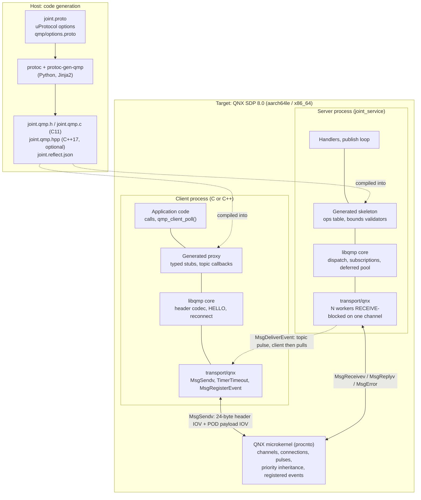

# qmp — service-oriented communication over QNX native message passing

[](https://github.com/miketsukerman/qmp/actions/workflows/host.yml)

qmp lets you describe a service in Protobuf (proto3, used as a **schema language only**),
annotated with [Eclipse uProtocol](https://github.com/eclipse-uprotocol/up-spec) service options,
and generates C11 bindings (plus optional header-only C++17 wrappers) whose transport is QNX
native message passing: `MsgSend`/`MsgReceive`/`MsgReply`, registered events and pulses.
No sockets, no varint encoding on the hot path — payloads are fixed-layout PODs, so the
synchronous semantics, priority inheritance and determinism of QNX IPC are kept and showcased.

An individual entry for the QNX Global Developer Hackathon 2026.

* Design: [docs/DESIGN.md](docs/DESIGN.md) · Decisions: [docs/DECISIONS.md](docs/DECISIONS.md)
* Open verification items against QNX SDP 8.0 / uProtocol: [docs/VERIFY.md](docs/VERIFY.md)
* Tutorial: [docs/codelab/](docs/codelab/) · Spikes: [docs/spikes/](docs/spikes/)

## Architecture



Each layer only calls the one below it. Handlers run on a libqmp worker at the
caller's priority (inherited through `MsgSend`); the server never sends to a
client, so topics use notify-then-pull over registered events. The same core
also runs over `transport/fake` (unit tests) and `transport/uds` (benchmarks
only). Details and sequence diagrams: [docs/DESIGN.md](docs/DESIGN.md).

## Status (0.3.2, W4)

| Area | State |
|------|-------|
| `protoc-gen-qmp` | sync and one-way methods: validated schema → C11 layouts with static asserts, ids, UUri constants, client stubs, ops table, reflection JSON. C++17 wrappers (`*.qmp.hpp`) and secpol emitter: not yet |
| `libqmp` core | header codec, UCode mapping, dispatch, version handshake, caller-provided storage; deferred replies (fixed pool), one-way calls, client timeouts with in-flight cancellation, disconnect/server-death lifecycle with reconnect, `acl_check` hook on kernel credentials; topics (notify-then-pull, LATEST/QUEUE with loss accounting, resubscribe on restart) |
| transports | `fake` (in-process, host tests, mirrors documented 8.0 kernel semantics); QNX native (`name_attach`, `MsgSendv`, unblock/disconnect pulses, registered events); `uds` (`AF_UNIX`/`SOCK_SEQPACKET`, host default, also built on QNX) for benchmarks and host integration tests only — **no priority inheritance** (ADR-004) |
| tools | `qmpctl list \| describe \| call \| subscribe`: C++17, links only the C ABI, no generated code — every generated service serves its own reflection JSON (`QMP_OP_REFLECT`, ADR-010) and qmpctl converts JSON ⇄ fixed-layout payloads from it ([Codelab 04](docs/codelab/04-inspect-with-qmpctl.md)) |
| examples | `qmp_joint_server` / `qmp_joint_client` (generated Joint bindings), `qmp_smoke` (hand-written service); two-process target scenarios in `scripts/target-smoke.sh` |
| tests | 128 GoogleTest cases: 94 in `qmp_core_tests` (22 over UDS, including two-process kill -9 scenarios) and 34 in `qmpctl_tests` (JSON codec checked against generated structs; commands run against live servers) + `joint_server --selftest` (host) + 58 codegen pytest cases, asan/ubsan/tsan clean |
| on target | RPi5, build `3527c7ed29fb` (2026-11-27, version 0.3.1): 97/97 `qmp_core_tests` cases (22 over UDS), `qmpctl_tests` 33/33 runnable on the native transport, 23/23 `scripts/target-smoke.sh` scenarios (four of them through `qmpctl`), including the one-way `Stop` whose handler runs at the server's own priority 10 for a priority-30 caller. Build `9598188d39ac` (version 0.3.0): `qmpctl_tests` 34/34 over UDS. Wire compatibility with the last pre-versioning build `3cd249234123` checked in both directions over the native transport (old server with new `qmpctl` and client, new server with old `qmpctl` and client). Build `a4230da3880c`: joint demo over `--transport uds` and `qnx`; results recorded in [docs/VERIFY.md](docs/VERIFY.md). Same-board round trip, `loop 5000` with a 5 s timeout: native median 4.0 µs / p99 5.7 µs, UDS median 57.8 µs / p99 68.5 µs (a first look, not the W4 benchmark) |
| bench | `bench/prio_inversion.c`: a priority-30 caller, a priority-10 server and a priority-15 CPU hog on one core, over native message passing, native without inheritance and UDS; `bench/run.sh` runs it on the board, `bench/plot.py` makes the table and chart |
| next | secpol generation, uProtocol adapter (W4, adapter is stretch); C++ wrappers in the generator (stretch) |

## Versioning

qmp follows [Semantic Versioning](https://semver.org/spec/v2.0.0.html). One version covers
`libqmp`, `protoc-gen-qmp` and `qmpctl`; it is defined once, in
[`include/qmp/qmp_version.h`](include/qmp/qmp_version.h). Releases are tags `vX.Y.Z` and
are described in [CHANGELOG.md](CHANGELOG.md). The rules for what counts as major, minor
and patch are in [ADR-011](docs/DECISIONS.md).

| Number | Now | Answers | Where |
|--------|-----|---------|-------|
| product version | 0.3.2 | which API, generator and tools do I have? | `QMP_VERSION_STRING`, `qmp_version_string()` |
| wire version | 1 | can these two processes talk? Equal means yes | `QMP_WIRE_VERSION`, exchanged in HELLO |
| reflection version | 1 | can this `qmpctl` read that service's description? | `qmp_reflect_version` in the reflection JSON |
| service version | per service | is this client compatible with that interface? | `(uprotocol.service_version_*)` in the `.proto` |

While the version is 0.y.z, a breaking change bumps the minor number, and generated code
must be regenerated for every new minor (the generated header refuses to compile
otherwise).

```sh
$ qmpctl --version
qmpctl 0.3.0 (wire 1, reflect 1) build=3cd249234123 transport=qnx
$ qmpctl --version --json
{"version":"0.3.0","build_version":"0.3.0","wire":1,"reflect":1,"build":"3cd249234123","transport":"qnx"}
```

`build` is the commit the binary was built from. A build that is not the release tag
itself reports build metadata after the version, for example `0.3.0+4.g3cd249234123` for
four commits after `v0.3.0`. `qmpctl describe <service>` shows the runtime, wire version
and generator of the remote service.

To release: bump `qmp_version.h` and `codegen/protoc_gen_qmp/__init__.py`, move
`[Unreleased]` in the changelog to the new version (`scripts/check-version.sh` checks all
three), merge, run the target tests on the board, then push an annotated tag
`vX.Y.Z`. The `release` workflow verifies the tag and publishes the GitHub Release.

## Build from a clean machine (Ubuntu 24.04, host build)

```sh
sudo apt-get install -y build-essential clang cmake ninja-build python3 python3-pip python3-venv \
                        protobuf-compiler clang-format clang-tidy cppcheck
git clone https://github.com/miketsukerman/qmp && cd qmp

python3 -m venv .venv && . .venv/bin/activate
pip install -e "codegen[dev]"          # protoc-gen-qmp + pytest/ruff/mypy/grpcio-tools

cmake --preset host-debug              # also: host-asan, host-ubsan, host-tsan, host-release
cmake --build build/host-debug
ctest --test-dir build/host-debug --output-on-failure
```

Expected tail of the `ctest` output:

```
100% tests passed, 0 tests failed out of 123
```

Generated bindings for the example service land in `build/host-debug/gen/joint/`
(`joint.qmp.h`, `joint.qmp.c`, `joint.reflect.json`). GoogleTest and nlohmann/json (qmpctl
only) are fetched with `FetchContent` on first configure (network needed once);
`-DQMP_BUILD_TOOLS=OFF` builds without qmpctl and without the JSON dependency.

### Try it: qmpctl against the demo server

```sh
export QMP_UDS_DIR=$(mktemp -d)
build/host-debug/examples/joint_demo/qmp_joint_server --publish-ms 50 &
alias qmpctl=$PWD/build/host-debug/tools/qmpctl/qmpctl

qmpctl list                                   # what is registered on this node
qmpctl describe Joint                         # interface, read from the running service
qmpctl call Joint SetTarget position_rad=1.5 max_velocity=2
qmpctl call Joint GetState --pretty
qmpctl subscribe Joint StateChanged --count 3 # one JSON line per update
```

On the QNX target the same commands run over native message passing; `list` walks
`/dev/name/local/qmp`.

### Codegen tests and lint

```sh
cd codegen
python3 -m pytest tests -q            # goldens, one fixture per validation error, C11/C++17 compile
ruff check . && ruff format --check . && mypy --strict protoc_gen_qmp tests
cd ..
clang-format --dry-run -Werror $(git ls-files 'include/**/*.h' 'runtime/**/*.[ch]' 'runtime/**/*.cpp' 'examples/**/*.c' 'tools/**/*.[ch]pp')
clang-tidy -p build/host-debug runtime/core/*.c runtime/transport/fake/*.c runtime/transport/uds/*.c
cppcheck --quiet --error-exitcode=1 --enable=warning,performance,portability --std=c11 \
         -Iinclude runtime/core runtime/transport/fake runtime/transport/uds examples/joint_demo/joint_server.c
```

Regenerate goldens on purpose only: `UPDATE_GOLDEN=1 python3 -m pytest tests -q`, then review
the diff.

### Running the generator by hand

```sh
protoc -I third_party/up-spec/up-core-api -I idl \
       --plugin=protoc-gen-qmp=$(which protoc-gen-qmp) \
       --qmp_out=flat:/tmp/gen idl/examples/demo/joint/v1/joint.proto
```

In CMake, `qmp_add_service(NAME joint PROTO idl/examples/demo/joint/v1/joint.proto)` does the
same (see `cmake/QmpCodegen.cmake`).

## QNX target build (manual — no SDP in CI)

Primary board: **Raspberry Pi 5** with the QNX SDP 8.0 quick-start target image (package
`com.qnx.qnx800.quickstart.rpi5`); bring-up guide: [`docs/target/rpi5.md`](docs/target/rpi5.md).
Image details (SDP patch level, security policy) are unverified — see `V-QNX-026`/`V-QNX-027`
in [`docs/VERIFY.md`](docs/VERIFY.md). Secondary board: Raspberry Pi 4 (one portability and
benchmark pass in the final week). x86_64 under QEMU is for functional development only — never
for headline latency numbers. Requires QNX SDP 8.0 installed on the host.

```sh
source ~/qnx800/qnxsdp-env.sh
cmake --preset qnx-aarch64le           # qcc -Vgcc_ntoaarch64le / q++ -Vgcc_ntoaarch64le_gpp
cmake --build build/qnx-aarch64le
# x86_64 (QEMU): cmake --preset qnx-x86_64
```

On QNX the runtime links the native transport (`runtime/transport/qnx/`); the target build
produces the core tests, `qmp_joint_server`/`qmp_joint_client`, `qmp_smoke`, `qmpctl` and its
tests. Set
`QMP_TARGET` to the board's SSH address, then copy and run one binary with
`scripts/target-run.sh`, or run every two-process scenario (timeouts, client/server death,
priority inheritance, cancellation, topics, qmpctl) with `scripts/target-smoke.sh`:

```sh
export QMP_TARGET=qnxuser@<pi5-address>
scripts/target-run.sh runtime/tests/qmp_core_tests
scripts/target-run.sh tools/qmpctl/tests/qmpctl_tests
scripts/target-smoke.sh
```

Walkthrough: [Codelab 02](docs/codelab/02-first-service-on-qnx.md).

### Priority-inversion benchmark

`bench/prio_inversion.c` puts three threads on one CPU: a server worker at priority 10, a
hog at priority 15 that spins for 20 ms and sleeps for 5 ms, and a client at priority 30
that calls `SetTarget` about every 7 ms and times each round trip. Over native message
passing the worker inherits the caller's priority and the hog cannot delay the call. Over
UDS, or on a native channel created with `_NTO_CHF_FIXED_PRIORITY` (the negative control),
the worker stays at 10 and the call waits for the hog to finish its burst.

```sh
export QMP_TARGET=qnxuser@<pi5-address>
bench/run.sh --calls 5000              # six runs, each pinned with `on -C 3`
bench/plot.py bench/results/<build id> # Markdown table on stdout, latency.svg in that directory
```

Each run prints one `result:` line and reports the priority the handler really ran at
(`handler_prio_min`/`handler_prio_max`). Results land in `bench/results/`, which git ignores.

Sanitizers on target: `-DQMP_SANITIZER=ubsan` (asan needs the shared runtime; no tsan on QNX —
use the host tsan preset).

## Repository layout

```
idl/                  qmp/options.proto (ext. 50000–50999), examples/demo/joint
third_party/up-spec/  pinned uProtocol protos (v1.5.8, Apache-2.0) — see PIN.md
codegen/              protoc-gen-qmp (Python ≥ 3.10, Jinja2) + golden tests
include/qmp/          public C ABI headers
runtime/core/         libqmp, OS-independent C11
runtime/transport/    fake (host tests), qnx (target), uds (bench/host tests only, no priority inheritance)
runtime/tests/        GoogleTest suites over the fake and uds transports
examples/joint_demo/  qmp_joint_server / qmp_joint_client: Joint actuator service in C
                      (--selftest on host; publisher/subscriber modes for topics)
examples/smoke/       qmp_smoke: hand-written service for target edge-case scenarios
tools/qmpctl/         qmpctl: list/describe/call/subscribe from reflection data (C++17, C ABI only)
bench/                prio_inversion.c (W4 benchmark), run.sh (run it on the board), plot.py
scripts/              target-run.sh, target-smoke.sh (SSH to the QNX board)
cmake/                presets support, qnx-*.cmake toolchains, QmpCodegen.cmake
docs/                 DESIGN, DECISIONS (ADRs), VERIFY register, codelab, spikes
```

## License

Apache-2.0 — see [LICENSE](LICENSE) and [NOTICE](NOTICE). Vendored uProtocol specs are
Apache-2.0 (Eclipse Foundation).
