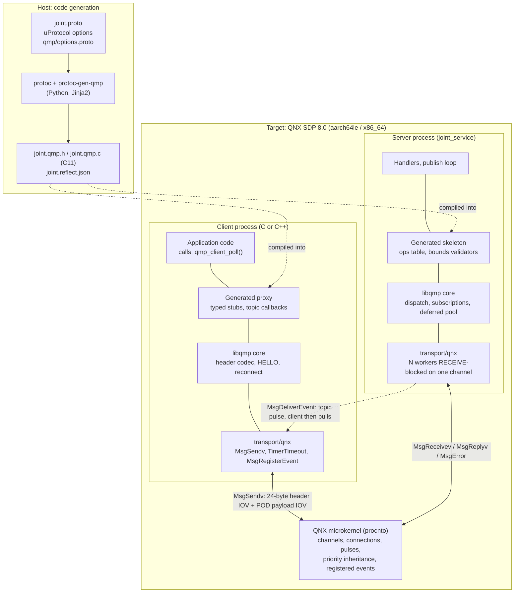

# qmp — service-oriented communication over QNX native message passing

[](https://github.com/miketsukerman/qmp/actions/workflows/host.yml)

qmp lets you describe a service in Protobuf (proto3, used as a **schema language only**),
annotated with [Eclipse uProtocol](https://github.com/eclipse-uprotocol/up-spec) service options,
and generates C11 bindings whose transport is QNX
native message passing: `MsgSend`/`MsgReceive`/`MsgReply`, registered events and pulses.
No sockets, no varint encoding on the hot path — payloads are fixed-layout PODs, so the
synchronous semantics, priority inheritance and determinism of QNX IPC are kept and showcased.

An individual entry for the QNX Global Developer Hackathon 2026, developed and tested on a
Raspberry Pi 5 running QNX SDP 8.0.

* Design: [docs/DESIGN.md](docs/DESIGN.md) · Decisions: [docs/DECISIONS.md](docs/DECISIONS.md)
* What was checked on the board, claim by claim: [docs/VERIFY.md](docs/VERIFY.md)
* Tutorial in five chapters: [docs/codelab/](docs/codelab/) · Changes: [CHANGELOG.md](CHANGELOG.md)

## What you get

| | |
|---|---|
| **A service is a `.proto` file** | Methods, one-way methods and topics with uProtocol ids. `protoc-gen-qmp` turns it into C11 structs with fixed layouts, typed client stubs, a server ops table and a reflection document. No serialization step at run time. |
| **Calls are kernel message passes** | A call is one `MsgSendv`; the handler runs on a server thread that the kernel has raised to the caller's priority. Timeouts, cancellation of a running handler, client death and server death with reconnect are handled by the runtime and tested on the board. |
| **Topics without server-to-client sends** | The server never blocks on a subscriber: it delivers a registered pulse and the subscriber pulls the sample (`LATEST` or a bounded `QUEUE`), with every lost update counted. |
| **A tool that needs no generated code** | `qmpctl list`, `describe`, `call` and `subscribe` work against any running service, because each service serves its own description. |
| **Evidence, not assumptions** | 48 statements about QNX 8.0 behaviour are tracked in [docs/VERIFY.md](docs/VERIFY.md), each with its status; a probe program and 23 two-process scenarios check them on the Pi. Three assumptions about the kernel turned out to be wrong and the design was corrected. |

## See it run on a Raspberry Pi 5

With QNX SDP 8.0 on the host and the quick-start image on the board
([details](#qnx-target-build-manual--no-sdp-in-ci)):

```sh
source ~/qnx800/qnxsdp-env.sh
cmake --preset qnx-aarch64le && cmake --build build/qnx-aarch64le
export QMP_TARGET=qnxuser@<pi5-address>

scripts/target-demo.sh      # 500 Hz topic stream, kill -9 of the server, automatic recovery
scripts/target-smoke.sh     # 23 scenarios: timeouts, deaths, priorities, topics, qmpctl
bench/run.sh                # priority inversion: native message passing against UDS
scripts/target-run.sh tools/probe/qmp_qnx_probe   # the kernel facts qmp relies on
```

The demo prints one line per second and ends with `DEMO PASSED`:

```
monitor: t=3s rate=500 Hz dropped=0 max_gap=2009.1us connected=1 generation=3482226736
joint_client: monitor: server gone (rc=3), reconnecting
joint_client: monitor: qmp_client_reconnect -> 0 (No error) generation=1383038233
monitor: t=12s rate=500 Hz dropped=0 max_gap=2042.6us connected=1 generation=1383038233
```

## Where QNX is used

Everything QNX-specific lives in one file,
[`runtime/transport/qnx/qnx_transport.c`](runtime/transport/qnx/qnx_transport.c); the core
above it is portable C11 and also runs on the host for tests.

| QNX facility | Where | What qmp uses it for |
|---|---|---|
| `ChannelCreate`, `dispatch_create_channel`, `name_attach` | `qnx_listen()` | One channel per service instance, published as `/dev/name/local/qmp/<service>-<instance>/v<major>`. The names are the service registry. |
| `name_open`, `MsgSendv`, `TimerTimeout` | `qnx_connect()`, `qnx_call()` | A method call: header and payload as two IOVs, with a kernel timeout that covers both the SEND- and the REPLY-blocked state. |
| `MsgReceive`, `MsgReplyv`, `MsgError` | `qnx_receive()`, `qnx_reply()`, `qnx_error()` | The worker loop. Transport errors travel as `MsgError`, application status in the reply header. |
| Priority inheritance across `MsgSend` | channel created without `_NTO_CHF_FIXED_PRIORITY` | A handler runs at its caller's priority. `--fixed-priority` turns it off as the negative control for the benchmark. |
| `_NTO_CHF_UNBLOCK`, `_PULSE_CODE_UNBLOCK`, `MsgInfo` (`_NTO_MI_UNBLOCK_REQ`), `MsgReceivePulse` | `qnx_receive_pulse()`, `qnx_unblock_req()` | Client timeouts and signals cancel the request in the server, also while every worker is busy. |
| `_NTO_CHF_DISCONNECT`, `_PULSE_CODE_DISCONNECT`, `ConnectDetach` | `qnx_handle_pulse()` | A dead client's parked requests and subscriptions are released. |
| `_NTO_CHF_COID_DISCONNECT`, `_PULSE_CODE_COIDDEATH` | `qnx_notify_open()`, `qnx_notify_wait()` | A client learns that its server died and reconnects. |
| `MsgRegisterEvent`, `SIGEV_MAKE_UPDATEABLE`, `MsgDeliverEvent` | `qnx_event_register()`, `qnx_deliver()` | Topics: only the subscribed-to server may deliver the pulse, and it carries the sequence number. |
| `ConnectClientInfo` | `qnx_fill_creds()` | Kernel-supplied pid, uid and gid for the `acl_check` hook. |
| `on -p`, `on -C`, `pidin`, `slay` | `scripts/target-smoke.sh`, `bench/run.sh` | Priorities, CPU pinning and kernel-state capture in the target scenarios. |

[`tools/probe/qnx_probe.c`](tools/probe/qnx_probe.c) exercises the same facilities without
libqmp, to check what the kernel really does.

## Architecture



Each layer only calls the one below it. Handlers run on a libqmp worker at the
caller's priority (inherited through `MsgSend`); the server never sends to a
client, so topics use notify-then-pull over registered events. The same core
also runs over `transport/fake` (unit tests) and `transport/uds` (benchmarks
only). Details and sequence diagrams: [docs/DESIGN.md](docs/DESIGN.md).

## Status (0.3.5, W4)

| Area | State |
|------|-------|
| `protoc-gen-qmp` | sync and one-way methods: validated schema → C11 layouts with static asserts, ids, UUri constants, client stubs, ops table, reflection JSON. C++17 wrappers (`*.qmp.hpp`) and secpol emitter: not yet |
| `libqmp` core | header codec, UCode mapping, dispatch, version handshake, caller-provided storage; deferred replies (fixed pool), one-way calls, client timeouts with in-flight cancellation, disconnect/server-death lifecycle with reconnect, `acl_check` hook on kernel credentials; topics (notify-then-pull, LATEST/QUEUE with loss accounting, resubscribe on restart) |
| transports | `fake` (in-process, host tests, mirrors documented 8.0 kernel semantics); QNX native (`name_attach`, `MsgSendv`, unblock/disconnect pulses, registered events); `uds` (`AF_UNIX`/`SOCK_SEQPACKET`, host default, also built on QNX) for benchmarks and host integration tests only — **no priority inheritance** (ADR-004) |
| tools | `qmpctl list \| describe \| call \| subscribe`: C++17, links only the C ABI, no generated code — every generated service serves its own reflection JSON (`QMP_OP_REFLECT`, ADR-010) and qmpctl converts JSON ⇄ fixed-layout payloads from it ([Codelab 04](docs/codelab/04-inspect-with-qmpctl.md)) |
| examples | `qmp_joint_server` / `qmp_joint_client` (generated Joint bindings), `qmp_smoke` (hand-written service); two-process target scenarios in `scripts/target-smoke.sh` |
| tests | 131 GoogleTest cases: 97 in `qmp_core_tests` (22 over UDS, including two-process kill -9 scenarios) and 34 in `qmpctl_tests` (JSON codec checked against generated structs; commands run against live servers) + `joint_server --selftest` (host) + 59 codegen pytest cases, asan/ubsan/tsan clean |
| on target | RPi5, build `6a20d54a805b` (2026-11-28, version 0.3.4): 97/97 `qmp_core_tests` cases (22 over UDS, and 97/97 again built with UBSan), `qmp_qnx_probe` passes all of its kernel checks, 23/23 `scripts/target-smoke.sh` scenarios (four of them through `qmpctl`), including the one-way `Stop` whose handler runs at the server's own priority 10 for a priority-30 caller; Build `45191631ff46` (version 0.3.3): `scripts/target-demo.sh` over `qnx` and `uds`: 500 updates per second with none dropped, `kill -9` of the server, automatic reconnect and resubscribe, 500 per second again. Build `3527c7ed29fb` (version 0.3.1): `qmpctl_tests` 33/33 runnable on the native transport. Build `9598188d39ac` (version 0.3.0): `qmpctl_tests` 34/34 over UDS. Wire compatibility with the last pre-versioning build `3cd249234123` checked in both directions over the native transport (old server with new `qmpctl` and client, new server with old `qmpctl` and client). Build `a4230da3880c`: joint demo over `--transport uds` and `qnx`; results recorded in [docs/VERIFY.md](docs/VERIFY.md). Same-board round trip, `loop 5000` with a 5 s timeout: native median 4.0 µs / p99 5.7 µs, UDS median 57.8 µs / p99 68.5 µs (a first look, not the W4 benchmark) |
| bench | `bench/prio_inversion.c`: a priority-30 caller, a priority-10 server and a priority-15 CPU hog on one core, over native message passing, native without inheritance and UDS; `bench/run.sh` runs it on the board, `bench/plot.py` makes the table and chart |
| not done | secpol generation from `qmp.allow_types`, the uProtocol `UTransport` adapter, C++17 wrappers and a shared-memory bulk path are designed in DESIGN.md but not implemented |

## Versioning

qmp follows [Semantic Versioning](https://semver.org/spec/v2.0.0.html). One version covers
`libqmp`, `protoc-gen-qmp` and `qmpctl`; it is defined once, in
[`include/qmp/qmp_version.h`](include/qmp/qmp_version.h). Releases are tags `vX.Y.Z` and
are described in [CHANGELOG.md](CHANGELOG.md). The rules for what counts as major, minor
and patch are in [ADR-011](docs/DECISIONS.md).

| Number | Now | Answers | Where |
|--------|-----|---------|-------|
| product version | 0.3.5 | which API, generator and tools do I have? | `QMP_VERSION_STRING`, `qmp_version_string()` |
| wire version | 1 | can these two processes talk? Equal means yes | `QMP_WIRE_VERSION`, exchanged in HELLO |
| reflection version | 1 | can this `qmpctl` read that service's description? | `qmp_reflect_version` in the reflection JSON |
| service version | per service | is this client compatible with that interface? | `(uprotocol.service_version_*)` in the `.proto` |

While the version is 0.y.z, a breaking change bumps the minor number, and generated code
must be regenerated for every new minor (the generated header refuses to compile
otherwise).

```sh
$ qmpctl --version
qmpctl 0.3.0 (wire 1, reflect 1) build=3cd249234123 transport=qnx
$ qmpctl --version --json
{"version":"0.3.0","build_version":"0.3.0","wire":1,"reflect":1,"build":"3cd249234123","transport":"qnx"}
```

`build` is the commit the binary was built from. A build that is not the release tag
itself reports build metadata after the version, for example `0.3.0+4.g3cd249234123` for
four commits after `v0.3.0`. `qmpctl describe <service>` shows the runtime, wire version
and generator of the remote service.

To release: bump `qmp_version.h` and `codegen/protoc_gen_qmp/__init__.py`, move
`[Unreleased]` in the changelog to the new version (`scripts/check-version.sh` checks all
three), merge, run the target tests on the board, then push an annotated tag
`vX.Y.Z`. The `release` workflow verifies the tag and publishes the GitHub Release.

## Build from a clean machine (Ubuntu 24.04, host build)

```sh
sudo apt-get install -y build-essential clang cmake ninja-build python3 python3-pip python3-venv \
                        protobuf-compiler clang-format clang-tidy cppcheck
git clone https://github.com/miketsukerman/qmp && cd qmp

python3 -m venv .venv && . .venv/bin/activate
pip install -e "codegen[dev]"          # protoc-gen-qmp + pytest/ruff/mypy/grpcio-tools

cmake --preset host-debug              # also: host-asan, host-ubsan, host-tsan, host-release
cmake --build build/host-debug
ctest --test-dir build/host-debug --output-on-failure
```

Expected tail of the `ctest` output:

```
100% tests passed, 0 tests failed out of 123
```

Generated bindings for the example service land in `build/host-debug/gen/joint/`
(`joint.qmp.h`, `joint.qmp.c`, `joint.reflect.json`). GoogleTest and nlohmann/json (qmpctl
only) are fetched with `FetchContent` on first configure (network needed once);
`-DQMP_BUILD_TOOLS=OFF` builds without qmpctl and without the JSON dependency.

### Try it: qmpctl against the demo server

```sh
export QMP_UDS_DIR=$(mktemp -d)
build/host-debug/examples/joint_demo/qmp_joint_server --publish-ms 50 &
alias qmpctl=$PWD/build/host-debug/tools/qmpctl/qmpctl

qmpctl list                                   # what is registered on this node
qmpctl describe Joint                         # interface, read from the running service
qmpctl call Joint SetTarget position_rad=1.5 max_velocity=2
qmpctl call Joint GetState --pretty
qmpctl subscribe Joint StateChanged --count 3 # one JSON line per update
```

On the QNX target the same commands run over native message passing; `list` walks
`/dev/name/local/qmp`.

### Codegen tests and lint

```sh
cd codegen
python3 -m pytest tests -q            # goldens, one fixture per validation error, C11/C++17 compile
ruff check . && ruff format --check . && mypy --strict protoc_gen_qmp tests
cd ..
clang-format --dry-run -Werror $(git ls-files 'include/**/*.h' 'runtime/**/*.[ch]' 'runtime/**/*.cpp' 'examples/**/*.c' 'tools/**/*.[ch]pp')
clang-tidy -p build/host-debug runtime/core/*.c runtime/transport/fake/*.c runtime/transport/uds/*.c
cppcheck --quiet --error-exitcode=1 --enable=warning,performance,portability --std=c11 \
         -Iinclude runtime/core runtime/transport/fake runtime/transport/uds examples/joint_demo/joint_server.c
```

Regenerate goldens on purpose only: `UPDATE_GOLDEN=1 python3 -m pytest tests -q`, then review
the diff.

### Running the generator by hand

```sh
protoc -I third_party/up-spec/up-core-api -I idl \
       --plugin=protoc-gen-qmp=$(which protoc-gen-qmp) \
       --qmp_out=flat:/tmp/gen idl/examples/demo/joint/v1/joint.proto
```

In CMake, `qmp_add_service(NAME joint PROTO idl/examples/demo/joint/v1/joint.proto)` does the
same (see `cmake/QmpCodegen.cmake`).

## QNX target build (manual — no SDP in CI)

Primary board: **Raspberry Pi 5** with the QNX SDP 8.0 quick-start target image (package
`com.qnx.qnx800.quickstart.rpi5`); bring-up guide: [`docs/target/rpi5.md`](docs/target/rpi5.md).
Image details (SDP patch level, security policy) are unverified — see `V-QNX-026`/`V-QNX-027`
in [`docs/VERIFY.md`](docs/VERIFY.md). Secondary board: Raspberry Pi 4 (one portability and
benchmark pass in the final week). x86_64 under QEMU is for functional development only — never
for headline latency numbers. Requires QNX SDP 8.0 installed on the host.

```sh
source ~/qnx800/qnxsdp-env.sh
cmake --preset qnx-aarch64le           # qcc -Vgcc_ntoaarch64le / q++ -Vgcc_ntoaarch64le_gpp
cmake --build build/qnx-aarch64le
# x86_64 (QEMU): cmake --preset qnx-x86_64
```

On QNX the runtime links the native transport (`runtime/transport/qnx/`); the target build
produces the core tests, `qmp_joint_server`/`qmp_joint_client`, `qmp_smoke`, `qmpctl` and its
tests. Set
`QMP_TARGET` to the board's SSH address, then copy and run one binary with
`scripts/target-run.sh`, or run every two-process scenario (timeouts, client/server death,
priority inheritance, cancellation, topics, qmpctl) with `scripts/target-smoke.sh`:

```sh
export QMP_TARGET=qnxuser@<pi5-address>
scripts/target-run.sh runtime/tests/qmp_core_tests
scripts/target-run.sh tools/qmpctl/tests/qmpctl_tests
scripts/target-smoke.sh
```

Walkthrough: [Codelab 02](docs/codelab/02-first-service-on-qnx.md).

### Joint demo: 500 Hz with kill and restart

`scripts/target-demo.sh [qnx|uds]` starts `qmp_joint_server --publish-ms 2`, which publishes
`StateChanged` at 500 Hz, and `qmp_joint_client monitor`, which prints the update rate, the
updates dropped and the longest gap once per second. After 4 s the script kills the server
with `-9` and restarts it 2 s later; the client reconnects and resubscribes by itself and
the readout returns to 500 Hz. The script checks each of those steps and ends with
`DEMO PASSED`.

### Priority-inversion benchmark

`bench/prio_inversion.c` puts three threads on one CPU: a server worker at priority 10, a
hog at priority 15 that spins for 20 ms and sleeps for 5 ms, and a client at priority 30
that calls `SetTarget` about every 7 ms and times each round trip. Over native message
passing the worker inherits the caller's priority and the hog cannot delay the call. Over
UDS, or on a native channel created with `_NTO_CHF_FIXED_PRIORITY` (the negative control),
the worker stays at 10 and the call waits for the hog to finish its burst.

```sh
export QMP_TARGET=qnxuser@<pi5-address>
bench/run.sh --calls 5000              # six runs, each pinned with `on -C 3`
bench/plot.py bench/results/<build id> # Markdown table on stdout, latency.svg in that directory
```

Each run prints one `result:` line and reports the priority the handler really ran at
(`handler_prio_min`/`handler_prio_max`). Results land in `bench/results/`, which git ignores.
Walkthrough, with the limits of priority inheritance that were measured on the board:
[Codelab 05](docs/codelab/05-priority-inversion.md).

Sanitizers on target: `-DQMP_SANITIZER=ubsan` (asan needs the shared runtime; no tsan on QNX —
use the host tsan preset).

## Repository layout

```
idl/                  qmp/options.proto (ext. 50000–50999), examples/demo/joint
third_party/up-spec/  pinned uProtocol protos (v1.5.8, Apache-2.0) — see PIN.md
codegen/              protoc-gen-qmp (Python ≥ 3.10, Jinja2) + golden tests
include/qmp/          public C ABI headers
runtime/core/         libqmp, OS-independent C11
runtime/transport/    fake (host tests), qnx (target), uds (bench/host tests only, no priority inheritance)
runtime/tests/        GoogleTest suites over the fake and uds transports
examples/joint_demo/  qmp_joint_server / qmp_joint_client: Joint actuator service in C
                      (--selftest on host; publisher/subscriber modes for topics)
examples/smoke/       qmp_smoke: hand-written service for target edge-case scenarios
tools/qmpctl/         qmpctl: list/describe/call/subscribe from reflection data (C++17, C ABI only)
bench/                prio_inversion.c (W4 benchmark), run.sh (run it on the board), plot.py
scripts/              target-run.sh, target-smoke.sh, target-demo.sh (SSH to the QNX board)
cmake/                presets support, qnx-*.cmake toolchains, QmpCodegen.cmake
docs/                 DESIGN, DECISIONS (ADRs), VERIFY register, codelab, spikes
```

## License

Apache-2.0 — see [LICENSE](LICENSE) and [NOTICE](NOTICE). Vendored uProtocol specs are
Apache-2.0 (Eclipse Foundation).
